<div align="center">

# Addressing the Missing Information in Depth Images Using the Iterative Learning Approach

**Mohamad Mofeed Chaar · Galia Weidl · Jamal Raiyn · Ahlam Chaar**

Connected Urban Mobility · Faculty of Engineering · Aschaffenburg University of Applied Sciences (TH Aschaffenburg), Germany

[](https://doi.org/10.1007/978-3-032-42044-2_11)
[](https://doi.org/10.5220/0013365900003941)
[](https://www.python.org/)
[](https://pytorch.org/)
[](https://www.cityscapes-dataset.com/)
[](LICENSE)

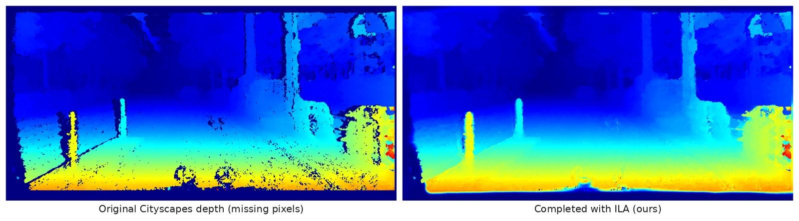

<em>Left: a Cityscapes stereo depth map. Missing measurements appear as dark-blue holes. Right: the same map completed by the Iterative Learning Approach.</em>

</div>

---

## Overview

Depth images are central to **Autonomous Driving Systems (ADS)**. They give a per-pixel distance to the surrounding scene and allow 2D images to be lifted into 3D. Stereo depth sensors, however, often fail to measure a large part of the image. In the **Cityscapes** dataset, an average of **1,206,898 pixels per image (≈ 57.5 %)** carry no valid depth value.

This repository contains the official implementation of the **Iterative Learning Approach (ILA)**, which reconstructs these missing values:

1. **Monocular depth prediction.** A U-Net learns to predict a dense depth map from a single RGB image, using the incomplete stereo depth maps as targets.
2. **Depth completion.** The predicted depth fills the missing (zero-valued) pixels of the original depth maps.
3. **Iterative refinement.** The completed maps become the new training targets, and a new model is trained. After six iterations, accuracy rises from **82.78 %** to **90.48 %**.
4. **Real-time correction model.** A second U-Net learns to map *incomplete → completed* depth images directly. It reaches **96.41 %** accuracy in **19 ms per frame**, about 42× faster than the 806 ms prediction-and-fill pipeline.

## Highlights

| | |
|---|---|
| 🎯 **Final depth-prediction accuracy** | **90.48 %** after 6 ILA iterations (+7.7 pp) |
| 🧩 **Missing pixels recovered** | **73.4 %** of all invalid pixels |
| ⚡ **Correction model** | **96.41 %** accuracy at **19 ms / frame** (RTX 4090) |
| 🌊 **Smoothness** | Laplacian variance 173.81 → 19.62; Tenengrad 3.45×10⁹ → 4.25×10⁸ |

---

## Table of Contents

- [Method](#method)
- [Results](#results)
- [Repository Structure](#repository-structure)
- [Installation](#installation)
- [Dataset Preparation](#dataset-preparation)
- [Usage](#usage)
- [Evaluation Metrics](#evaluation-metrics)
- [Hardware](#hardware)
- [Citation](#citation)
- [License](#license)
- [Acknowledgements](#acknowledgements)
- [Contact](#contact)

---

## Method

### 1. Depth from stereo, and why pixels are missing

Cityscapes provides synchronized left/right images. Depth is recovered from disparity:

$$
Z = \frac{B \cdot f}{\text{disparity}}, \qquad \text{disparity} = \frac{p - 1}{256}
$$

where $B = 0.22\,\text{m}$ is the stereo baseline, $f$ the focal length, and $p$ the pixel value of the disparity image. **A value of $p = 0$ marks an invalid measurement.** Occlusions, texture-less surfaces and the image borders produce these holes.

<p align="center">
  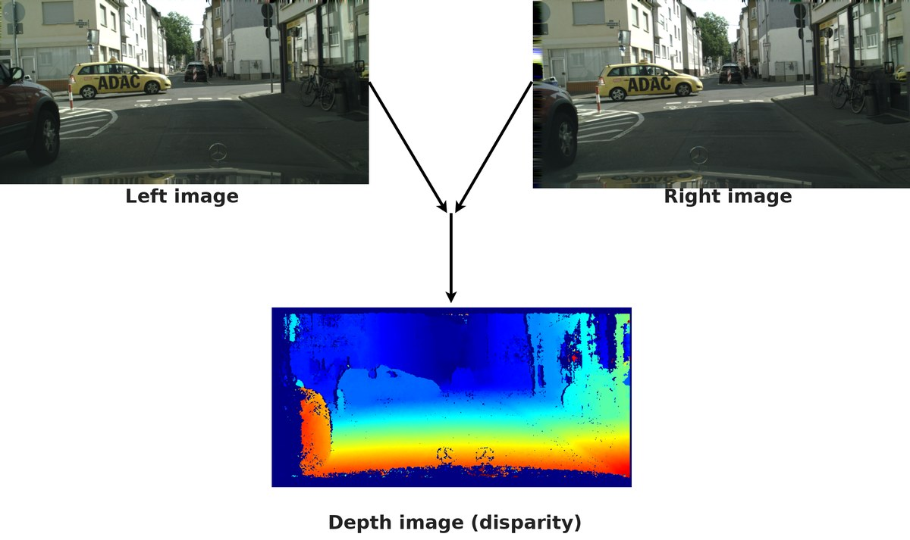
  &nbsp;
  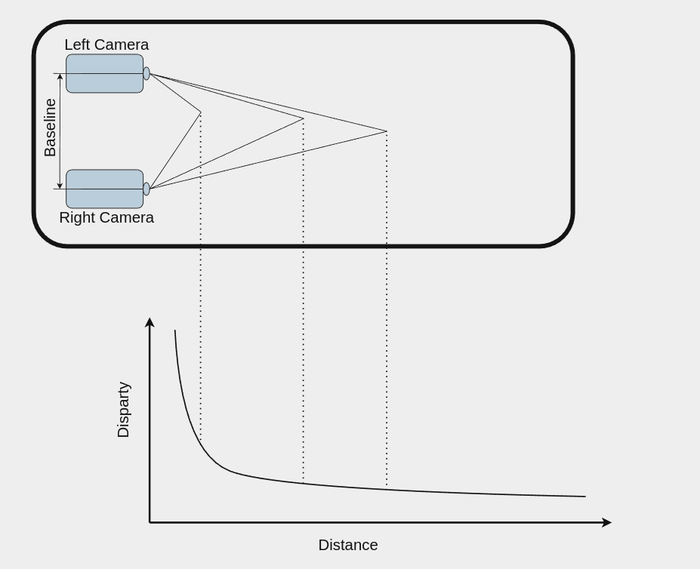
</p>

<p align="center">
  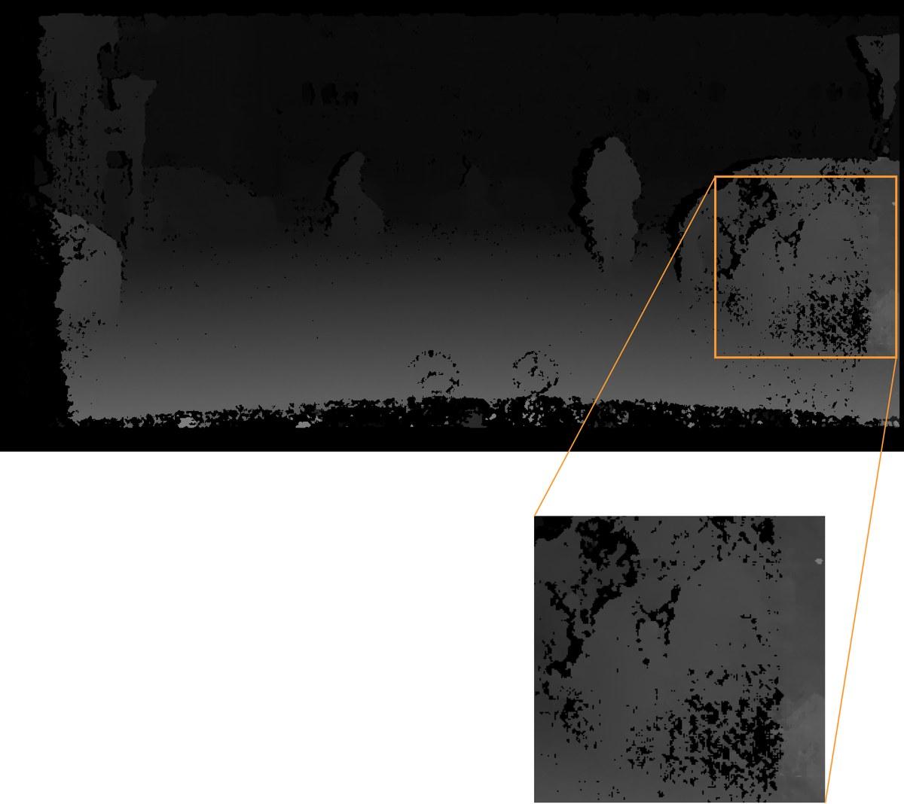
  <br><em>Black pixels in a raw Cityscapes depth image are invalid measurements.</em>
</p>

### 2. U-Net for monocular depth prediction

A U-Net encoder–decoder (features 64 → 128 → 256 → 512, 1024 bottleneck) takes the **left RGB image** (480 × 320) as input. It regresses a single-channel depth map and is trained with the **MSE loss**.

<p align="center">
  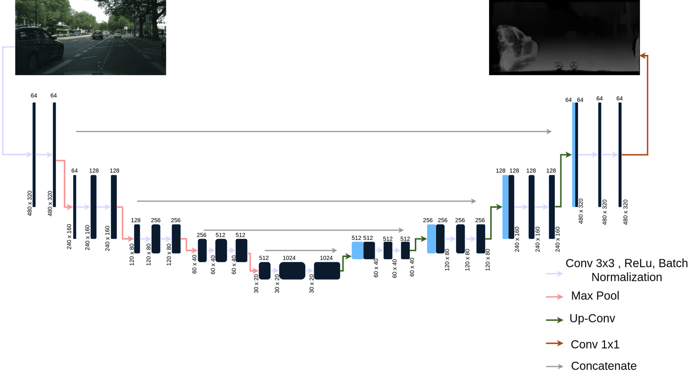
</p>

### 3. Filling missing pixels (Algorithm 1)

```text
Input : original depth image D (with zeros), trained model M, RGB image I
Output: completed depth image D*
P  ← M(I)                       # predict a dense depth map
D* ← D
for every pixel (x, y) with D(x, y) = 0:
    D*(x, y) ← P(x, y)          # keep valid stereo values, fill only the holes
```

<p align="center">
  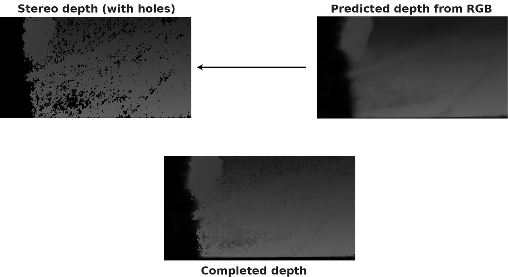
</p>

### 4. Iterative Learning Approach (Algorithm 2)

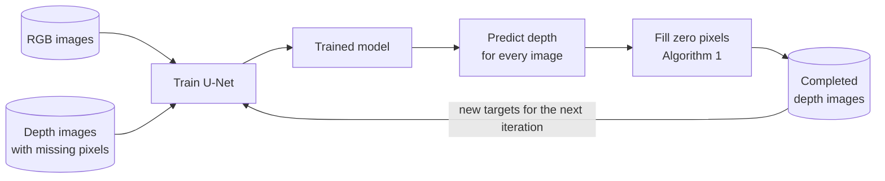

Each iteration trains a **new** model on the most recent completed depth maps. Better targets give a better model, and a better model gives better targets. Six iterations were enough on Cityscapes: the sixth adds only +0.29 pp.

### 5. Direct correction model

The pairs *(raw depth with holes → ILA-completed depth)* from the final iteration are used to train a second U-Net. Its input is the incomplete depth image, so missing regions are corrected in a single forward pass, with no RGB prediction and no per-pixel loop.

---

## Results

### Accuracy and recovered pixels per iteration

| Iteration | Accuracy ↑ | Corrected pixels ↑ | Laplacian variance ↓ | Tenengrad ↓ |
|:---:|:---:|:---:|:---:|:---:|
| 0 (raw Cityscapes) | – | – | 173.81 | 3.45 × 10⁹ |
| 1 | 82.78 % | 58.3 % | 41.10 | 9.33 × 10⁸ |
| 2 | 88.16 % | 65.8 % | 27.60 | 6.25 × 10⁸ |
| 3 | 89.11 % | 70.5 % | 23.47 | 5.23 × 10⁸ |
| 4 | 89.83 % | 72.5 % | 21.43 | 4.71 × 10⁸ |
| 5 | 90.19 % | 73.3 % | 20.13 | 4.39 × 10⁸ |
| **6** | **90.48 %** | **73.4 %** | **19.62** | **4.25 × 10⁸** |

Lower Laplacian variance and lower Tenengrad energy mean the filled pixels blend smoothly with their neighbours and add no artificial edges.

### Correction model

| Method | Accuracy | Time / frame |
|---|:---:|:---:|
| ILA prediction + pixel-wise filling | 90.48 % | 806 ms |
| **U-Net correction model (depth → depth)** | **96.41 %** | **19 ms** |

### Training curves

<p align="center">
  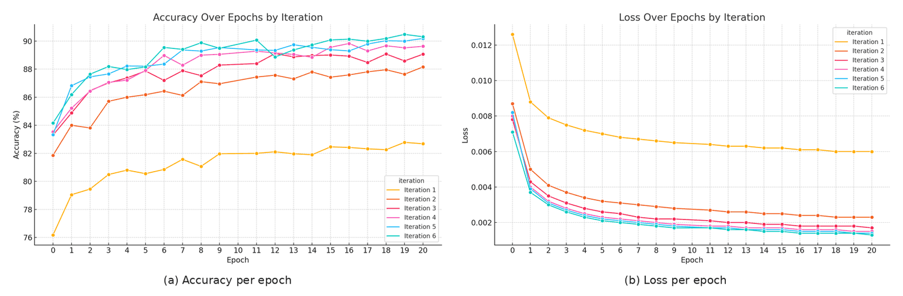
</p>

<details>
<summary>First iteration only (raw Cityscapes targets)</summary>
<p align="center">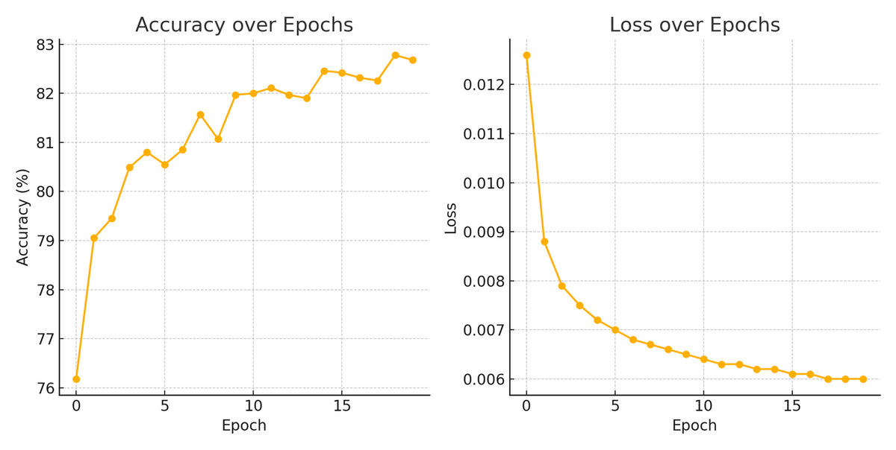</p>
</details>

### Qualitative results

**Lindau (validation set):**

<p align="center">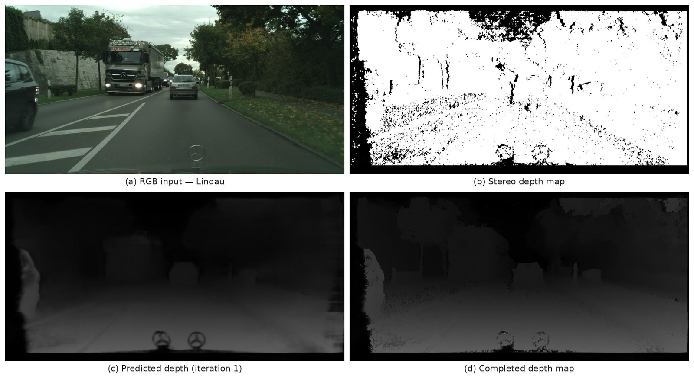</p>

**Frankfurt (validation set):**

<p align="center">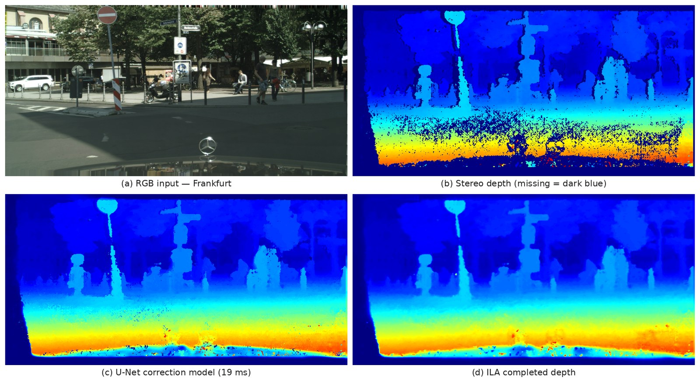</p>

<details>
<summary>Grayscale vs. colorized depth</summary>
<p align="center">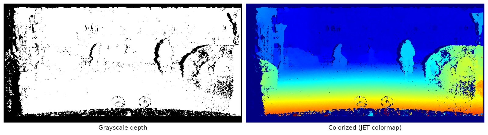</p>
Depth maps are colorized with OpenCV's JET colormap for visualization only (see <code>colormap-depth.py</code>).
</details>

---

## Repository Structure

```text
Improve-depth-images/
├── model.py                  # U-Net (DoubleConv blocks, 64-128-256-512 features)
├── dataset.py                # PyTorch Dataset: image + depth target (normalized by 126)
├── data_utils.py             # Builds & aligns the Cityscapes file lists → CSV files
├── config.py                 # Lightweight YAML config loader
├── yaml_files/
│   └── data.yaml             # Dataset root paths and camera side (left/right/both)
├── utils.py                  # Data loaders, accuracy metric, checkpoints, path helpers
├── train.py                  # Training loop (Adam, MSE, AMP, best-model checkpointing)
├── make_sample.py            # Predict a depth map for a single RGB image
├── colormap-depth.py         # Colorize a 16-bit disparity image (JET colormap)
├── turotial.ipynb            # Step-by-step notebook: predict → fill missing pixels
├── improve-depth-image/
│   ├── main.py               # Algorithm 1 over the whole dataset + statistics (JSON)
│   ├── utils.py              # get_predection(), correct_zeros_in_image(), save_img()
│   └── model.py              # U-Net (same as root, needed for torch.load)
├── smothness-validation/
│   └── validate.py           # Laplacian variance & Tenengrad over a dataset folder
├── assets/                   # Figures used in this README
├── img/                      # Example outputs across iterations
└── LICENSE                   # Apache-2.0
```

---

## Installation

```bash
git clone https://github.com/Mofeed-Chaar/Improve-depth-images.git
cd Improve-depth-images

python -m venv .venv
source .venv/bin/activate            # Windows: .venv\Scripts\activate

# Install PyTorch for your CUDA version first: https://pytorch.org/get-started/locally/
pip install torch torchvision
pip install -r requirements.txt
```

A CUDA-capable GPU is strongly recommended. Training uses automatic mixed precision (`torch.amp`).

---

## Dataset Preparation

1. Register at [cityscapes-dataset.com](https://www.cityscapes-dataset.com/downloads/) and download:
   - `leftImg8bit_sequence_trainvaltest`
   - `rightImg8bit_sequence_trainvaltest` (optional, only for `cam_side: right/both`)
   - `disparity_sequence_trainvaltest`

2. Arrange them as follows (or edit `yaml_files/data.yaml`):

   ```text
   Data/cityscapes/depth/
   ├── leftImg8bit_sequence/{train,test,val}/<city>/*.png
   ├── rightImg8bit_sequence/{train,test,val}/<city>/*.png
   └── disparity_sequence_trainvaltest/disparity_sequence/{train,test,val}/<city>/*.png
   ```

3. Build the aligned file lists:

   ```bash
   python data_utils.py
   ```

   This sorts every RGB image against its disparity map, checks the pairing, and writes `data_trainE.csv` and `data_valE.csv`. Rename them to `data_train.csv` and `data_val.csv`, which the training scripts read. As in the papers, the **train and test splits are merged for training (135,000 images)** and the **val split (15,000 images)** is kept for evaluation.

---

## Usage

### 1. Train the depth-prediction model (one ILA iteration)

In `train.py`, select the RGB → depth file lists:

```python
TRAIN_IMG_DIR, TRAIN_MASK_DIR, VAL_IMG_DIR, VAL_MASK_DIR, TESR_DIR, TEST_MASK_DIR = \
    get_data_dirs(number_images=None, test=16)
```

then run:

```bash
mkdir -p model saved_images highst_images_acc
python train.py
```

| Hyper-parameter | Value |
|---|---|
| Input size | 480 × 320 |
| Optimizer | Adam, lr = 1e-4 |
| Loss | MSE |
| Batch size | 16 |
| Epochs | 20 |
| Augmentation | Rotate ±35°, horizontal flip (p = 0.5), vertical flip (p = 0.1) |

Outputs: `model/highst_acc_model.pt` (best validation accuracy), `model/model_epoch_*.pt`, `model/model_final.pt`, `results.csv` (accuracy and loss per epoch), and sample predictions in `saved_images/` and `highst_images_acc/`.

### 2. Fill the missing pixels (Algorithm 1)

```bash
cd improve-depth-image
python main.py
```

The script loads `model/highst_acc_model.pt`, predicts a depth map for every image, replaces only the zero-valued pixels, and saves the completed maps under `Data/improve_depth/…`, keeping the original folder layout. It also writes `json_result_file.json` with the average number of missing pixels, the pixels left unchanged, and a histogram of the filled disparity values.

### 3. Iterate (ILA)

Point the targets of the next training round to the completed maps from the previous round, then repeat steps 1–2. In the papers this was done **six times** (`improve_depth_level_1 … improve_depth_level_6`).

### 4. Train the direct correction model (depth → depth)

`train.py` uses this mode by default:

```python
TRAIN_IMG_DIR, ... = get_data_dirs_mask(number_images=None, test=16)
```

Inputs are the raw disparity maps and targets are the ILA-completed maps. Set the `path` argument of `get_data_dirs_mask()` in `utils.py` to your final completed dataset, then run `python train.py`.

### 5. Single-image inference

Edit the paths at the top of `make_sample.py` (model checkpoint and image), then:

```bash
python make_sample.py
```

The prediction is resized back to 2048 × 1024 and saved as a 16-bit PNG in Cityscapes disparity format. To visualize it:

```bash
python colormap-depth.py
```

The notebook [`turotial.ipynb`](turotial.ipynb) walks through prediction and hole filling on a single Cityscapes image.

### 6. Smoothness validation

Set `path_images` in `smothness-validation/validate.py` to a dataset folder, then:

```bash
python smothness-validation/validate.py
```

The script prints the mean Laplacian variance and mean Tenengrad focus measure over all images.

---

## Evaluation Metrics

**Accuracy**: absolute error normalized by the total ground-truth magnitude:

$$
\text{Accuracy}(\%) = \left(1 - \frac{\sum_{P}\lvert P - \hat P\rvert}{\sum_{P} P}\right)\times 100
$$

**Corrected pixels**: share of the originally invalid pixels that received a valid value:

$$
\text{Corrected}(\%) = \frac{\text{avg. corrected pixels}}{\text{avg. black pixels}}\times 100
$$

**Smoothness**: Laplacian variance $\sigma^2(\nabla^2 I)$ and Tenengrad $T=\sum_{x,y}\left(G_x^2+G_y^2\right)$ with Sobel gradients. Lower values mean smoother and more coherent completed depth maps.

---

## Hardware

All experiments ran on an **NVIDIA RTX 4090**, an **Intel Core i9-14900K** and **64 GB RAM (4000 MT/s)**. The reported timings (806 ms vs. 19 ms per frame) refer to this setup.

---

## Citation

If you use this code or the completed depth maps in your research, please cite:

```bibtex
@inproceedings{chaar2027ila,
  title     = {Addressing the Missing Information in Depth Images Using the Iterative Learning Approach},
  author    = {Chaar, Mohamad Mofeed and Weidl, Galia and Chaar, Ahlam},
  booktitle = {Smart Cities, Green Technologies, and Intelligent Transport Systems
               (SMARTGREENS 2025, VEHITS 2025)},
  series    = {Communications in Computer and Information Science},
  volume    = {3158},
  pages     = {207--225},
  publisher = {Springer, Cham},
  year      = {2027},
  doi       = {10.1007/978-3-032-42044-2_11}
}

@inproceedings{chaar2025predicting,
  title     = {Predicting Depth Maps from Single RGB Images and Addressing Missing Information in Depth Estimation},
  author    = {Chaar, Mohamad Mofeed and Raiyn, Jamal and Weidl, Galia},
  booktitle = {Proceedings of the 11th International Conference on Vehicle Technology
               and Intelligent Transport Systems -- VEHITS},
  pages     = {549--556},
  publisher = {SciTePress},
  organization = {INSTICC},
  year      = {2025},
  doi       = {10.5220/0013365900003941}
}
```

---

## License

This project is released under the [Apache License 2.0](LICENSE).
The Cityscapes dataset is subject to its own [terms of use](https://www.cityscapes-dataset.com/license/). It is not redistributed here.

## Acknowledgements

- The [Cityscapes](https://www.cityscapes-dataset.com/) team for the dataset and `cityscapesScripts`.
- Ronneberger et al. for the original [U-Net](https://arxiv.org/abs/1505.04597) architecture.
- The Connected Urban Mobility group at TH Aschaffenburg.

## Contact

**Mohamad Mofeed Chaar**: [MohamadMofeed.Chaar@th-ab.de](mailto:MohamadMofeed.Chaar@th-ab.de) · ORCID [0000-0001-9637-5832](https://orcid.org/0000-0001-9637-5832) · GitHub [@Mofeed-Chaar](https://github.com/Mofeed-Chaar)

Questions, issues and pull requests are welcome.
